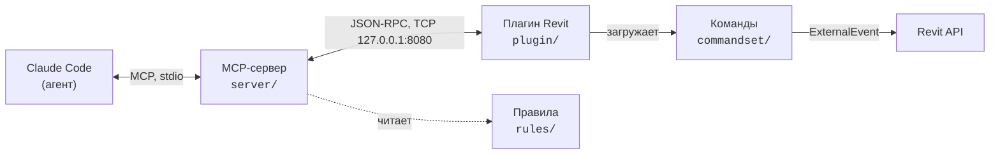

# tiver-mcp-plugin

**Агент Claude работает в Autodesk Revit: создаёт и правит семейства, работает с моделью проекта, проверяет результат по правилам проекта.**

Связь идёт через MCP (Model Context Protocol). Агент получает от MCP-сервера каталог инструментов — команд Revit — и вызывает их. Плагин внутри Revit выполняет команды через Revit API. Основная задача команды TiverGroup — моделирование серий семейств (арматура, фитинги, коллекторы) по исходным данным заказчика и правилам проекта.

## Как устроено



| Часть | Что делает |
|---|---|
| MCP-сервер (TypeScript, `server/`) | Каталог инструментов для агента: описания и схемы аргументов. Пересылает вызовы в Revit, собирает правила моделирования, запускает Revit. |
| Плагин (C#, `plugin/`) | Надстройка Revit. Слушает порт только на `127.0.0.1`, находит команду по имени и передаёт её в главный поток Revit. |
| Команды (C#, `commandset/`) | Работа с Revit API: редактор семейств (`commandset/Family/`), модель проекта, топография, выполнение кода. Одна сборка `RevitMCPCommandSet.dll`. |
| Правила (`rules/`) | Профили правил моделирования: общие, пакеты (ADSK), проекты. Наследуются через `extends`. |

## Возможности

- **97 инструментов**: 85 команд Revit и 12 инструментов самого сервера.
- **Редактор семейств.** Создание по шаблону, формы (выдавливание, вращение, сдвиг, по сечениям), опорные плоскости и размеры с параметрами, параметры и формулы, таблицы выбора, коннекторы MEP, вложенные семейства, материалы, проверка гибкости. Работа идёт в закреплённой сессии: семейство открыто, пока его не закроют.
- **Правила моделирования.** `get_family_rules` отдаёт агенту правила профиля со всеми слоями, `check_family_rules` проверяет семейство: pass / warn / fail по каждому правилу и список правил для ручной проверки.
- **Запуск Revit агентом.** `launch_revit` поднимает Revit нужной версии с включённым сервером, без кнопок и без открытого документа. Несколько Revit одновременно — `list_revit_instances`, `use_revit_instance`.
- **Наборы команд.** Global — общие команды, наборы проектов (Alterplast) — то, чем пользуется проект. Окно Settings плагина показывает команды по наборам и категориям.
- **Скрипты проекта.** Удачный код для `send_code_to_revit` сохраняется в `projects/<проект>/scripts/` и запускается по имени, без сборки.

## Требования

| Что | Версия |
|---|---|
| Windows | 10 / 11 |
| Autodesk Revit | 2019–2026 (основная рабочая — 2019) |
| Node.js | 20+ |
| .NET SDK | 8 (сборка всех версий; для 2019–2024 нужен также .NET Framework 4.8 Developer Pack) |
| Claude Code | приложение или CLI |

## Быстрый старт для разработчика

1. **Склонировать** репозиторий и собрать сервер:

   ```bash
   git clone https://github.com/TiverGroupDevelopment/tiver-mcp-plugin.git
   cd tiver-mcp-plugin
   npm --prefix server ci
   npm --prefix server run build
   ```

2. **Собрать плагин и команды** под свою версию Revit (пример — 2019):

   ```bash
   dotnet build tiver-mcp-plugin.sln -c "Release R19"
   ```

   Конфигурации: `Release R19` … `Release R26`. Результат — `plugin/bin/AddIn <год> <конфигурация>/`.

3. **Установить** (Revit этой версии должен быть закрыт):

   ```powershell
   .\scripts\install-local.ps1 -Year 2019
   ```

   Скрипт копирует плагин и команды в `%APPDATA%\Autodesk\Revit\Addins\<год>\`, делает резервную копию прежней установки и пересобирает реестр команд.

4. **Открыть Claude Code в корне репозитория.** MCP-сервер `revit-local` подключается из [.mcp.json](.mcp.json) — подтвердите доверие к нему при первом запуске.

5. **Указать папку исходных данных** (эталонные семейства из профилей правил) в `.claude/settings.local.json` — файл не попадает в git:

   ```json
   { "env": { "REVIT_MCP_DATA_DIR": "D:\\Семейства" } }
   ```

6. **Попросить агента:** «Запусти Revit 2019». При первом запуске после сборки Revit спросит про надстройку без подписи — нажмите «Загрузить один раз» или «Всегда загружать».

## Работа с агентом

Примеры запросов:

- «Запусти Revit 2019 и создай семейство типовой модели» — `launch_revit`, `new_family`.
- «Смоделируй кран по ИД из папки … по правилам Альтерпласта» — агент читает `get_family_rules profile: "alterplast"`, моделирует командами семейств, проверяет `check_family_rules`.
- «Проверь это семейство по правилам коллекторов» — `check_family_rules profile: "alterplast-multiport"`.
- «Какие команды есть у Альтерпласта?» — `list_command_sets set: "Alterplast"`.

Без названного проекта действуют только общие правила `global`. Все команды доступны агенту всегда.

## Наборы команд и категории

Код всех команд лежит в одном месте. Набор — это список: поле `sets` у каждой команды в [command.json](command.json) говорит, к каким наборам она относится.

```json
{ "commandName": "new_family", "section": "session", "status": "validated",
  "sets": ["Global", "Alterplast"], "parameters": [{ "name": "template", "required": true }] }
```

| Набор | Команд | Что входит |
|---|---|---|
| Global | 84 C# + 12 серверных | всё, что пригодится в любом проекте |
| Alterplast | 56 | все команды прежнего набора семейств; `create_family_inspection_copy` — только здесь |

- **`section`** — категория из [sections.json](sections.json): геометрия, опорные плоскости и размеры, параметры, таблицы выбора, коннекторы, топография и т. д. (15 категорий).
- **`status`** — `validated` (проверена) или `experimental`.
- **`parameters`** — входные параметры, заполняются скриптом из схем инструментов сервера.

Как команда проекта становится общей — [PROMOTION.md](PROMOTION.md).

## Правила моделирования

```
rules/
├── global/                      общие правила (draft)
├── adsk/                        пакет: параметры ADSK
├── Альтерпласт/                 проект: extends [global, adsk]
├── Альтерпласт_коллекторы/      проект: extends alterplast
└── _шаблон/                     шаблон нового профиля
```

Профиль — `profile.json` (автоматические проверки, соглашения, ФОП) и тексты правил по разделам. Слои складываются от общего к частному. Подробно — [rules/README.md](rules/README.md).

## Новый проект

```powershell
.\scripts\new-project.ps1 -Id proplan -Name "ПроПлан" -Extends global,adsk -SharedParameterFile "D:\ФОП\ФОП2022.txt"
```

Создаёт профиль правил, карточку проекта и папку скриптов. Свой набор команд проект заводит в `commandSets` файла `command.json`.

## Скрипты

| Скрипт | Что делает |
|---|---|
| `scripts/install-local.ps1 -Year <год>` | установить плагин и команды в Revit; `-AutoStart on` — сервер стартует при любом запуске Revit; `-Port` — свой порт |
| `node scripts/check-integrity.mjs` | сверка: манифест ↔ C#-классы ↔ инструменты сервера, наборы, категории, профили правил. Запускать перед сборкой |
| `node scripts/sync-command-parameters.mjs` | записать параметры команд в манифест из схем собранного сервера (`--check` — только проверить) |
| `scripts/new-project.ps1` | завести новый проект моделирования |
| `scripts/release.ps1` | поднять версию для выпуска (см. «Выпуск») |

## Как добавить команду

Коротко: C#-обработчик и команда в `commandset/`, запись в `command.json` (`section`, `status`, `sets`), инструмент в `server/src/tools/`, затем:

```bash
node scripts/check-integrity.mjs
npm --prefix server run build
node scripts/sync-command-parameters.mjs
dotnet build tiver-mcp-plugin.sln -c "Release R19"
```

Пошагово — [MCP добавить новые команды локально.md](MCP%20добавить%20новые%20команды%20локально.md).

## Структура репозитория

```
tiver-mcp-plugin/
├── command.json            манифест: все команды, их наборы, категории, параметры
├── sections.json           категории команд и разделы правил
├── commandset/             команды Revit (C#): модель проекта; Family/ — редактор семейств
├── plugin/                 надстройка Revit (C#): сервер сокета, загрузка команд, окно Settings
├── server/                 MCP-сервер (TypeScript): инструменты, правила, запуск Revit
├── rules/                  профили правил моделирования
├── projects/               карточки и скрипты проектов
├── scripts/                установка, сверка, новый проект
├── tests/                  интеграционные тесты (TUnit, живой Revit)
├── tiver-mcp-plugin.sln    решение: плагин, команды, тесты
└── .mcp.json               подключение MCP-сервера для Claude Code
```

## Документация

| Документ | О чём |
|---|---|
| [PROMOTION.md](PROMOTION.md) | общее и проектное: наборы команд, ступени команды, критерии переноса в Global |
| [MCP добавить новые команды локально.md](MCP%20добавить%20новые%20команды%20локально.md) | как добавить команду: три слоя, манифест, сборка |
| [rules/README.md](rules/README.md) | профили правил, наследование, проверки |
| [MULTI_PORT.ru.md](MULTI_PORT.ru.md) | несколько Revit одновременно, порты |
| [План тестирования](План%20тестирования%20команд%20семейств.md), [отчёт](Отчёт%20тестирования%20команд%20семейств.md) | проверка команд семейств |

## Безопасность

- Плагин слушает порт только на `127.0.0.1`: среди команд есть выполнение произвольного кода (`send_code_to_revit`), из сети он недоступен.
- Сервер плагина сам поднимается только у Revit, запущенного агентом (`launch_revit`). Revit, открытый вручную, порт не открывает, пока не нажата кнопка или не включён автозапуск.
- Плагин не подписан: после каждой пересборки Revit спрашивает про надстройку без подписи.

## Логи

- Плагин: `%APPDATA%\Autodesk\Revit\Addins\<год>\revit_mcp_plugin\Logs\mcp_<дата>.log` (кнопка **Open Logs** в окне Settings).
- Сервер пишет в stderr, его показывает Claude Code (`/mcp`).

## Тесты

Интеграционные тесты команд модели проекта — в `tests/commandset/`, на [Nice3point.TUnit.Revit](https://github.com/Nice3point/RevitUnit). Нужны .NET 10 SDK и запущенный Revit 2025 или 2026:

```bash
dotnet test -c Debug.R26 -r win-x64 tests/commandset
```

Команды семейств проверяются по [плану тестирования](План%20тестирования%20команд%20семейств.md) в живом Revit.

## Выпуск

Выпуск по тегу `v*` — workflow [.github/workflows/release.yml](.github/workflows/release.yml) и `scripts/release.ps1` — пока не настроен: workflow собирает Revit 2020–2026 без 2019 и публикует сервер в npm. Перед первым выпуском его нужно доработать: добавить 2019 и решить, нужна ли публикация в npm.

## Лицензия

[MIT](LICENSE).
